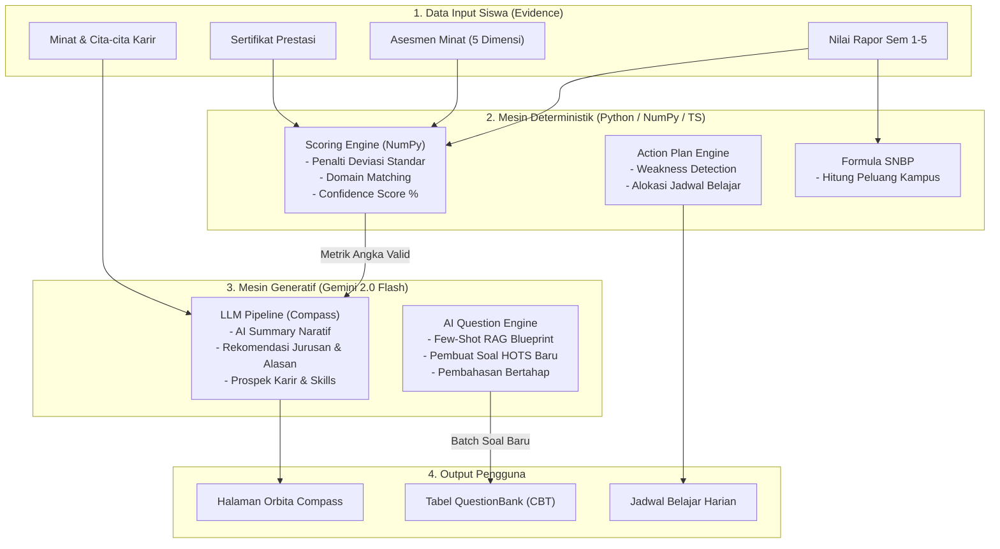

# 🧠 Arsitektur & Kategorisasi Penggunaan AI di Sistem Orbidu (Orbita-Compass)

Dokumen ini menjelaskan peta penggunaan teknologi **Kecerdasan Buatan (AI)** di seluruh ekosistem Orbidu, membedakan secara tegas antara bagian yang ditenagai oleh **Large Language Model (LLM - Google Gemini 2.0 Flash)** dan bagian yang menggunakan **kode Python / algoritma matematika biasa**.

---

## 🏛️ Filosofi Arsitektur: *Hybrid Intelligence*

Orbidu mengadopsi prinsip **pemisahan tanggung jawab (*separation of concerns*)**:
1. **Angka, statistik, dan aturan kelulusan TIDAK diserahkan ke LLM** untuk menghindari risiko halusinasi (*hallucination*), inkonsistensi nilai, dan latensi lambat.
2. **Bahasa naratif, penalaran kontekstual, dan kreativitas diserahkan ke LLM** untuk menghasilkan pengalaman bimbingan personal yang luwes seperti berkonsultasi dengan Guru BK profesional.

---

## 🤖 1. Kategori: Menggunakan LLM (Google Gemini 2.0 Flash)

Bagian ini memanfaatkan **Generative AI** untuk mengolah teks tidak terstruktur, memahami konteks minat personal, dan memproduksi konten baru:

### A. Narasi Rekomendasi Jurusan & Karir (Orbita Compass)
* **Berkas Sumber**:
  - Python: [`ai-engine/llm_pipeline.py`](file:///home/naufal/Projects/Orbita-Compass/ai-engine/llm_pipeline.py)
  - Backend API: [`backend-api/src/utils/aiClient.ts`](file:///home/naufal/Projects/Orbita-Compass/backend-api/src/utils/aiClient.ts)
* **Model yang Digunakan**: `gemini-2.0-flash`
* **Input ke LLM**:
  - Hasil hitungan skor valid dari NumPy (Confidence Score, Alignment Status, Top Strengths).
  - Target jurusan dan PTN impian siswa.
  - Jawaban refleksi minat terbuka dan cita-cita karir siswa.
* **Output yang Dihasilkan LLM**:
  1. **`ai_summary`**: Analisis naratif 2–3 kalimat yang menyoroti kekuatan profil siswa dan memberikan arahan pengembangan.
  2. **`recommended_majors`**: Daftar 2–3 jurusan alternatif yang selaras, lengkap dengan persentase kecocokan dan alasan rasionalnya (*rationale*).
  3. **`recommended_careers`**: Pilihan profesi masa depan yang relevan, deskripsi pekerjaan, dan daftar keahlian (*skills required*) yang wajib diasah sejak SMA.

---

### B. Generator Soal CBT & Pembahasan Bertahap (Dapur Bank Soal)
* **Berkas Sumber**:
  - Engine: [`backend-api/src/services/aiQuestionService.ts`](file:///home/naufal/Projects/Orbita-Compass/backend-api/src/services/aiQuestionService.ts)
  - Controller: [`backend-api/src/controllers/ptnController.ts`](file:///home/naufal/Projects/Orbita-Compass/backend-api/src/controllers/ptnController.ts)
* **Model yang Digunakan**: `gemini-2.0-flash` (Structured Output Schema / `application/json`)
* **Input ke LLM**:
  - Kategori ujian (`SNBT`, `SKD Kedinasan`, `TKA`), subtes, topik materi, dan level kesulitan (Easy/Medium/Hard HOTS).
  - Contoh soal asli terverifikasi (*few-shot exemplars*) dari [`question_blueprints.json`](file:///home/naufal/Projects/Orbita-Compass/backend-api/prisma/data/question_blueprints.json).
* **Output yang Dihasilkan LLM**:
  1. **Teks Soal / Stimulus**: Cerita atau wacana ilmiah baru yang orisinal.
  2. **Pilihan Jawaban**: Tepat 5 opsi jawaban (A, B, C, D, E) dengan pengecoh (*distractors*) yang berkualitas tinggi.
  3. **Kunci & Pembahasan**: `answerIndex` (0–4) dan penjelasan konseptual mengapa jawaban tersebut benar serta mengapa opsi lainnya salah.
* **Sifat Eksekusi**: Dijalankan secara **Batch oleh Admin** (bukan per klik siswa) untuk disimpan ke database `QuestionBank`.

---

## ⚙️ 2. Kategori: Menggunakan Kode Python / Algoritma Biasa (Tanpa LLM)

Bagian ini sengaja dieksekusi menggunakan **kode deterministik murni** untuk menjaga akurasi mutlak, kecepatan tinggi (< 10ms), dan hemat biaya server:

### A. Scoring Engine Keselarasan Profil (NumPy)
* **Berkas Sumber**: [`ai-engine/scoring.py`](file:///home/naufal/Projects/Orbita-Compass/ai-engine/scoring.py) (dimirror di [`backend-api/src/utils/aiClient.ts`](file:///home/naufal/Projects/Orbita-Compass/backend-api/src/utils/aiClient.ts))
* **Teknologi**: Python + NumPy
* **Logika Matematis**:
  1. **Konsistensi Rapor**:
     $$\text{Consistency} = \max(0, \min(100, \mu_{\text{rapor}} - 0.5 \times \sigma_{\text{rapor}}))$$
     *(Siswa dengan nilai fluktuatif/standar deviasi tinggi mendapat penalti konsistensi).*
  2. **Domain-Weighted Matching**:
     Pencocokan kata kunci prodi target ke bobot 5 dimensi asesmen (misal: *Teknik Informatika* = 40% Teknologi + 30% Riset + 30% Rata-rata; *Kedokteran* = 40% Riset + 20% Teknologi + 40% Rata-rata; *Hukum* = 40% Komunikasi + 30% Kepemimpinan + 30% Rata-rata).
  3. **Formula Indeks Keyakinan (Confidence Score)**:
     $$\text{Confidence} = 0.45 \times \text{RaporConsistency} + 0.35 \times \text{AssessmentMatch} + 0.20 \times (\min(20, N_{\text{prestasi}} \times 5) \times 5)$$
  4. **Penentuan Status Keselarasan**:
     - `ALIGNED`: Confidence $\ge 80\%$ dan Interest Match $\ge 75\%$.
     - `PARTIAL`: Confidence $\ge 65\%$.
     - `MISALIGNED`: Confidence $< 65\%$.
  5. **Top Strengths**: Deteksi otomatis bidang unggul jika skor dimensi $\ge 80$.

---

### B. Ingestion & Ekstraktor Arsip Soal 300MB
* **Berkas Sumber**: [`backend-api/scripts/extract_soal_archive.py`](file:///home/naufal/Projects/Orbita-Compass/backend-api/scripts/extract_soal_archive.py)
* **Teknologi**: Python murni (`zipfile`, `re`, `xml.etree.ElementTree`, `subprocess`) + Poppler `pdftotext`
* **Logika**:
  - Membaca 422 file dalam arsip zip tanpa harus mengekstrak ke disk (in-memory stream).
  - Parsing struktur XML berkas Word DOCX untuk 110 soal SKD CAT dan 675 soal TKA 15 mapel.
  - Memasangkan berkas PDF Soal dan Pembahasan untuk 141 soal UTBK 2024 dan 125 soal Bimbel Alternatifa menggunakan Regex tingkat lanjut.
  - Menghasilkan 1.051 butir soal bersih terstruktur di `master_questions.json`.

---

### C. Penjadwalan Latihan Belajar Adaptif (Adaptive Action Plan)
* **Berkas Sumber**: [`frontend/src/data/actionPlanEngine.ts`](file:///home/naufal/Projects/Orbita-Compass/frontend/src/data/actionPlanEngine.ts)
* **Teknologi**: TypeScript Algoritma
* **Logika**:
  - **Weakness Detection**: Membaca rekam jejak akurasi latihan dan tryout siswa per subtes.
  - **Pemberian Bobot Dinamis**: Subtes dengan nilai akurasi paling rendah akan diprioritaskan muncul lebih sering pada slot hari belajar yang dipilih siswa (30, 60, atau 90 menit per hari).
  - **State Freezing**: Membekukan jadwal hari yang sudah lewat agar riwayat belajar siswa tetap konsisten.

---

### D. Rasionalisasi Peluang SNBP
* **Berkas Sumber**: [`backend-api/src/controllers/ptnController.ts`](file:///home/naufal/Projects/Orbita-Compass/backend-api/src/controllers/ptnController.ts) (`getRationalization`)
* **Teknologi**: TypeScript Formula
* **Logika**:
  - Menghitung rata-rata seluruh nilai rapor semester 1–5 dengan bobot 85%.
  - Menambahkan poin sertifikat prestasi (2,5 poin per sertifikat) dengan bobot 15%.
  - Mengkategorisasikan peluang kelolosan kampus: `Tinggi` ($\ge 75$), `Sedang` ($65–74$), atau `Tantangan` ($< 65$).

---

### E. Penilaian Tryout & Koreksi Server-Side (CBT)
* **Berkas Sumber**: [`backend-api/src/controllers/ptnController.ts`](file:///home/naufal/Projects/Orbita-Compass/backend-api/src/controllers/ptnController.ts) (`submitPracticeAnswers`)
* **Teknologi**: TypeScript + Prisma ORM
* **Logika**:
  - Menerima `userAnswers` dari frontend.
  - Mencocokkan jawaban terhadap `answerIndex` asli di database secara tertutup.
  - Mengkalkulasi skor akhir (skala 0–1000 untuk UTBK atau 0–550 untuk SKD) dan menyajikan pembahasan lengkap kepada siswa setelah pengerjaan selesai.

---

## 📊 Matriks Perbandingan Ringkas

| Dimensi | Bagian LLM (Gemini 2.0 Flash) | Bagian Kode Biasa (Python / TS) |
| :--- | :--- | :--- |
| **Fungsi Utama** | Narasi, penalaran kualitatif, pembuatan soal HOTS | Perhitungan nilai, matriks bobot, parsing arsip, koreksi |
| **Tingkat Kepastian** | Stokastik / probabilistik (kreatif & kontekstual) | 100% Deterministik (matematis & presisi) |
| **Kecepatan / Latensi** | 1–3 detik per eksekusi | < 10 milidetik (instan) |
| **Kebutuhan Jaringan** | Butuh koneksi internet & API Key Google | Offline / Lokal penuh |
| **Biaya Operasional** | Berbasis kuota token (dihemat via batching) | Nol biaya (gratis di server sendiri) |

---

## 🛡️ Mekanisme *Graceful Fallback* (Anti-Mogok)

Untuk menjamin layanan tidak pernah mati (*zero downtime*):
1. Jika koneksi ke Google Gemini terputus atau kuota API habis, baik [`ai-engine/llm_pipeline.py`](file:///home/naufal/Projects/Orbita-Compass/ai-engine/llm_pipeline.py), [`aiClient.ts`](file:///home/naufal/Projects/Orbita-Compass/backend-api/src/utils/aiClient.ts), maupun [`aiQuestionService.ts`](file:///home/naufal/Projects/Orbita-Compass/backend-api/src/services/aiQuestionService.ts) memiliki **Adaptive Rule-Based Engine & Archive Synthesis**.
2. Sistem otomatis menyajikan rekomendasi dan butir soal cadangan dari arsip 1.051 soal asli tanpa memunculkan pesan *error 500* kepada siswa.
